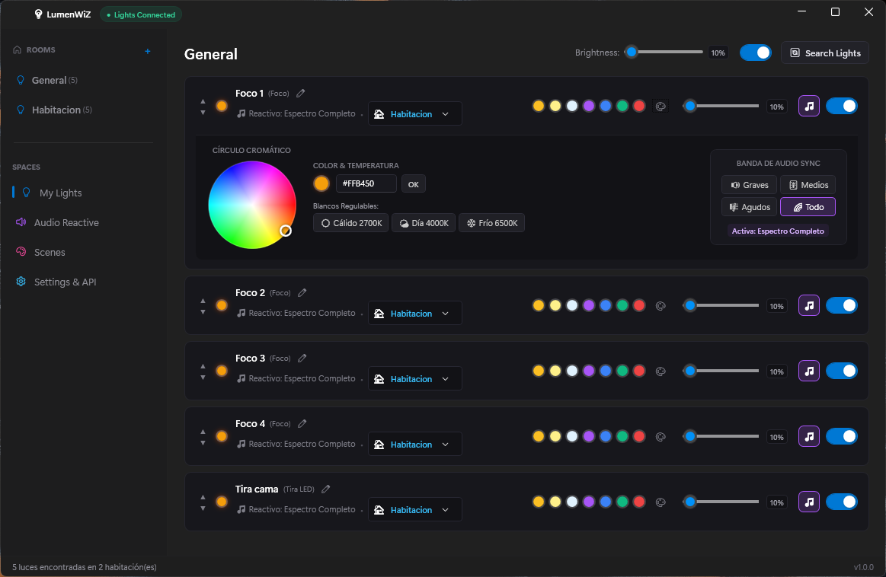
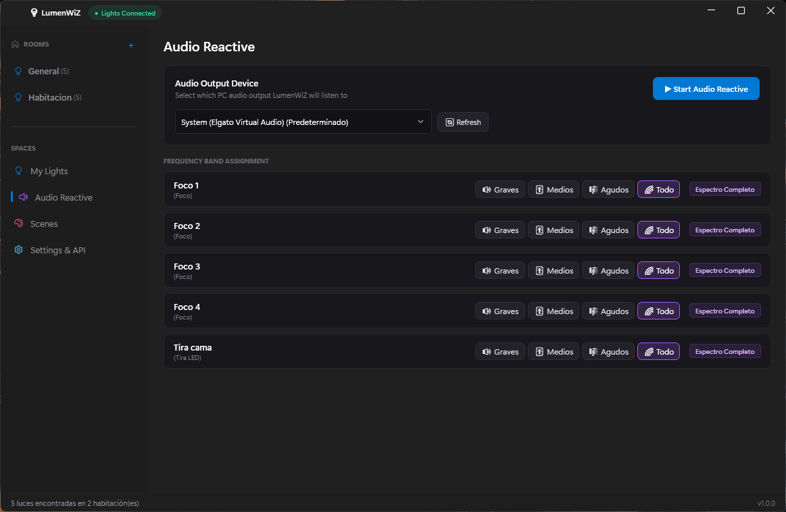
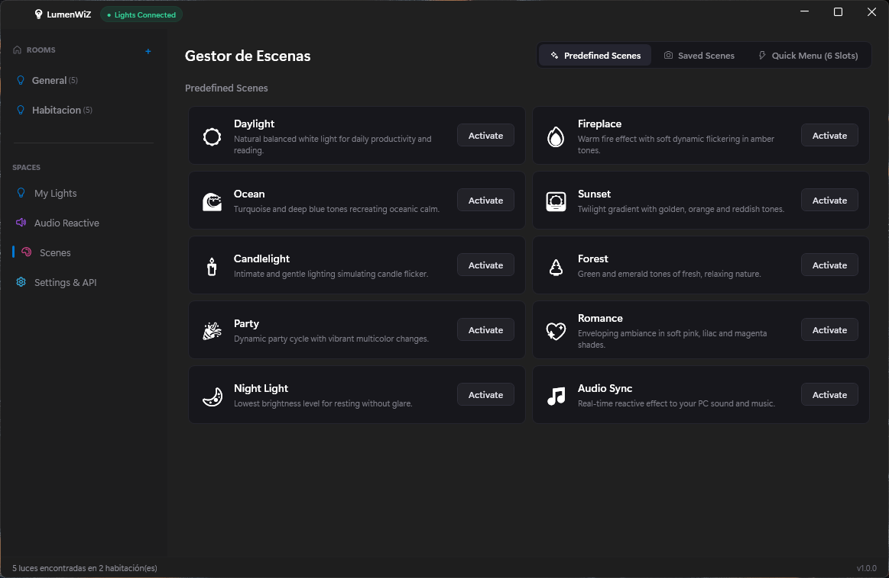
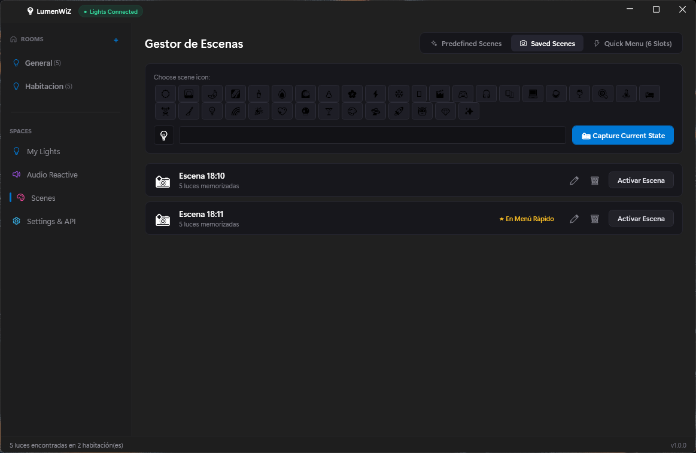
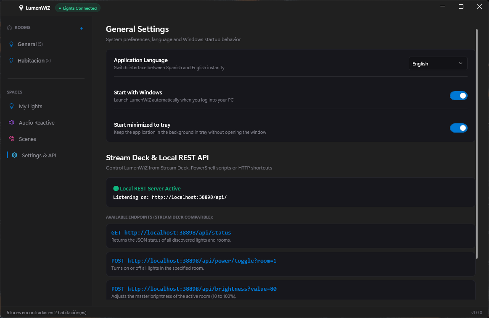

# 💡 LumenWiZ

Aplicación nativa para Windows (x64) diseñada para el control local, ultrarrápido y sin intermediarios de bombillas y tiras LED WiZ Connected.

---

## 📌 ¿Qué es la aplicación?

**LumenWiZ** es un software de escritorio para Windows 10 y Windows 11 que permite administrar y controlar dispositivos de iluminación inteligente WiZ directamente desde tu computadora. 

Funciona de manera **100% local**, sin requerir cuentas de usuario, sin servicios en la nube de terceros y sin latencia externa. Se integra con el sistema operativo a través de un panel de control rápido en la bandeja del sistema (System Tray) y una consola completa de gestión por habitaciones.

---

## ⚙️ ¿Qué es lo que hace?

* **Detección Automática de Dispositivos**: Escanea y empareja en milisegundos todas las bombillas y tiras LED WiZ presentes en la red Wi-Fi local mediante escaneo paralelo por subred.
* **Control por Habitaciones y Focos Individuales**:
  * Encendido y apagado maestro o por foco individual.
  * Ajuste de brillo continuo (1% al 100%).
  * Temperatura de color blanco (Kelvin) y selector cromático RGB en tiempo real.
  * Creación y administración de habitaciones personalizadas.
* **Sincronización Audio Reactiva (WASAPI Loopback)**:
  * Las luces reaccionan en tiempo real a la música, videos o juegos que reproduce Windows.
  * Captura de audio digital directa del sistema (sin micrófono, inmune a ruidos de ambiente).
  * Mapeo de frecuencias de audio por bandas (Graves, Medios, Agudos) asignables a cada foco.
* **Gestor de Escenas de Iluminación**:
  * **Escenas de fábrica**: Acceso directo a las escenas dinámicas programadas en el chip de WiZ (Océano, Chimenea, Atardecer, Fiesta, Vela, etc.).
  * **Escenas guardadas**: Captura instantánea de la configuración de todos los focos de una habitación con un solo clic para restaurarla en cualquier momento.
  * **Menú Rápido (6 Ranuras)**: Configuración de accesos directos personalizables en la barra de tareas.
* **Integración con Stream Deck & API REST Local**:
  * Servidor HTTP local embebido (puerto `38898`).
  * Endpoints REST para encender, apagar, cambiar brillo o disparar escenas desde Elgato Stream Deck o automatizaciones externas.
* **Ajustes de Sistema**:
  * Interfaz bilingüe completa con cambio de idioma en vivo (**Español** e **Inglés**).
  * Opciones para iniciar automáticamente con Windows e iniciar minimizado en la bandeja del sistema.

---

## 🔬 ¿Cómo funciona?

LumenWiZ opera bajo una arquitectura distribuida local de baja latencia:

```
┌─────────────────┐       UDP Broadcast / Unicast (Port 38899)       ┌────────────────────────┐
│  LumenWiZ (PC)  │ ───────────────────────────────────────────────> │ Focos / Tiras LED WiZ  │
│                 │ <─────────────────────────────────────────────── │ (Respuesta en < 5 ms)  │
└────────┬────────┘                      JSON-RPC                    └────────────────────────┘
         │
         ├─── WASAPI Loopback Audio ──> Analizador FFT (3 bandas) ──> Lazo de control (25 FPS)
         │
         ├─── Servidor HTTP (Port 38898) <── Stream Deck / Macros locales
         │
         └─── Persistencia Local ──> %APPDATA%\LumenWiZ\config.json
```

1. **Protocolo WiZ UDP (Puerto 38899)**:
   * La aplicación envía y recibe datagramas UDP con mensajes JSON-RPC (`setPilot`, `getPilot`, `syncPilot`) directamente a la dirección IP de cada bombilla.
   * La respuesta es inmediata (inferior a 5 milisegundos) y funciona incluso si no hay conexión a Internet.
2. **Captura Digital de Audio (WASAPI Loopback)**:
   * Intercepta el buffer de renderizado del dispositivo de salida de audio predeterminado de Windows.
   * Procesa la señal con un filtro espectral por transformada de Fourier rápida (FFT), dividiendo la señal en Graves (20–150 Hz), Medios (150–2500 Hz) y Agudos (2.5–16 kHz).
   * Un limitador de velocidad estabiliza la tasa a 25 cuadros por segundo para garantizar máxima fluidez sin saturar el microcontrolador de las luces.
3. **Servidor API REST Local (Puerto 38898)**:
   * Levanta un listener HTTP local que recibe solicitudes `GET` y `POST`.
   * Permite interactuar con la iluminación mediante llamadas HTTP estándar desde Stream Deck, scripts de PowerShell o herramientas de automatización.
4. **Almacenamiento Local**:
   * Todas las preferencias, nombres de focos, orden, asignación de habitaciones y escenas se guardan en `%APPDATA%\LumenWiZ\config.json`.

---

## 📸 Capturas de Pantalla

<!-- Espacio reservado para las 4 capturas de pantalla -->

| Control de Habitaciones y Selector Cromático | Sincronización Audio Reactiva (WASAPI) |
|:---:|:---:|
|  |  |

| Escenas Predefinidas de Fábrica | Captura de Escenas Personalizadas |
|:---:|:---:|
|  |  |

| Ajustes Generales & API REST Local / Stream Deck |
|:---:|
|  |

---

## 📥 Instalación

### Opción 1: Instalador Asistido (Recomendado)
Descarga el instalador ejecutable desde la sección de **Releases** o compílalo localmente:
* **Archivo**: `LumenWiZ-Setup-v1.0.0.exe`
* Incluye asistente de instalación, accesos directos en el menú Inicio y Escritorio, y configuración automática de inicio con Windows.

### Opción 2: Versión Portátil (Standalone)
* Descomprime o ejecuta directamente `LumenWiZ.UI.exe` sin requerir instalación. No requiere tener el SDK de .NET instalado previamente.

---

## 🔌 API REST Local para Stream Deck

Ejemplos de comandos disponibles en `http://localhost:38898`:

| Acción | Método | Endpoint |
|---|---|---|
| **Ver estado y habitaciones** | `GET` | `/api/rooms` |
| **Alternar encendido de habitación** | `POST` | `/api/rooms/{roomId}/toggle?state=true` |
| **Ajustar brillo de habitación** | `POST` | `/api/rooms/{roomId}/brightness?value=80` |
| **Activar escena personalizada** | `POST` | `/api/scenes/activate?name={nombreEscena}` |
